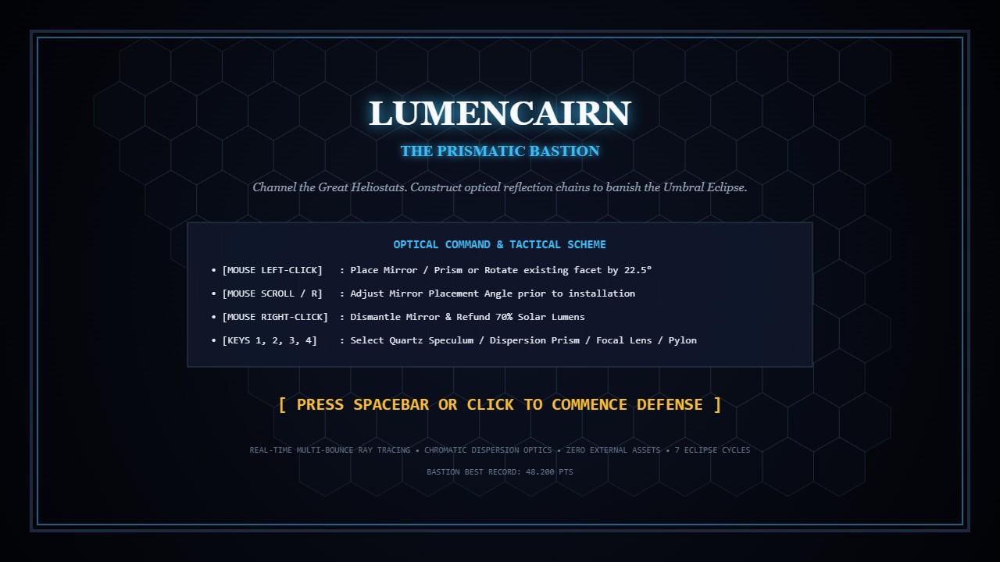

# LUMENCAIRN: The Prismatic Bastion

  

> An authentic offline optical ray-tracing defense & prismatic puzzle strategy game built for the [make.fun best-game-01](https://make.fun/bounty/best-game-01) competition.

---

## ⚙️ Narrative & Celestial Premise

Upon the ancient celestial summit of **Mount Solarium**, the sacred Lumencairn Bastion harnesses the pure rays of primordial heliostats to keep the Umbral Eclipse at bay. Seven dark eclipse cycles have begun, and legions of light-devouring shadow-stalkers, obsidian rams, and phase wraiths march to smother the central crystal core.

As the Luminary Architect, manipulate geometric light paths across an isometric hexagonal citadel. Position precision quartz speculums, optical beam-splitters, hyperbolic focal lenses, and resonant crystal pylons to weave lethal multi-bounce light networks that incinerate the darkness.

---

## 🎮 Gameplay Features

* **Authentic 100% Offline Static Web Runtime**: Zero external network dependencies, CDNs, or bundled asset packs. Runs instantly from static files in any modern desktop browser.
* **Real-Time Multi-Bounce Ray Tracing**: Custom deterministic vector reflection physics (`r = d - 2(d·n)n`). Beams reflect off angled mirror facets with photon energy retention.
* **Chromatic Dispersion Optics**: Prisms split incident white solar rays into component wavelengths:
  * *Ruby Red*: Superheated thermal radiation that melts heavy obsidian armor.
  * *Sapphire Blue*: Cryo-kinetic resonance that crystallizes and slows swift phase wraiths.
  * *Amber Fusion*: Concentrated focal energy delivering massive single-target destruction.
* **The Prism Forge & Celestial Codex**: Spend salvaged Solar Lumens between combat cycles across 4 research branches: *Vitreous Silica Polishing*, *Tri-Chromatic Dispersion*, *Focal Caustic Overdrive*, and *Resonant Crystal Capacitors*.
* **Procedural Multi-Voice Web Audio Synthesizer**: Zero audio recordings. Crystal singing bowl tones, glass harp overtones, optical ratchets, and solar fanfares are synthesized procedurally in real-time.
* **7-Cycle Eclipse Progression**: Face escalating waves of shadow entities culminating in a battle against *The Umbral Leviathan*.

---

## 🕹️ Controls

| Action | Control |
| :--- | :--- |
| **Place Mirror / Rotate Facet** | `Mouse Left-Click` (Places on empty hex, rotates by 22.5° if occupied) |
| **Adjust Installation Angle** | `Mouse Scroll Wheel` or `Key R / E / Q` |
| **Dismantle Mirror (Refund 70%)**| `Mouse Right-Click` |
| **Select Quartz Speculum (50L)**| `Key 1` |
| **Select Chromatic Prism (95L)** | `Key 2` |
| **Select Focal Lens (120L)** | `Key 3` |
| **Select Resonant Pylon (150L)**| `Key 4` |
| **Navigate Codex / Forge** | `W / S` or `Up / Down`, `Enter` to craft, `Space` to begin cycle |

---

## 🏗️ Technical Architecture

* **Entrypoint**: `main.ts` (Node 22 ESM runtime)
* **Viewport Resolution**: 1280 × 720 fixed aspect ratio canvas with vector-crisp rendering
* **Engine Modules**:
  * `game/src/config.js`: Balancing matrices, 7-wave schemas, and chromatic spectrum definitions.
  * `game/src/math/optics.js`: Specular vector reflection, line intersections, and raycaster.
  * `game/src/math/hex.js`: Axial hex coordinate conversions and polygon geometry.
  * `game/src/audio.js`: Zero-asset procedural Web Audio synthesizer.
  * `game/src/input.js`: Normalized hex coordinate mapping and precision rotation controls.
  * `game/src/particles.js`: Object-pooled optical particle simulator (photon sparks, halos, embers).
  * `game/src/systems/bastion.js`: Bastion core integrity and solar lumen reserves.
  * `game/src/systems/codex.js`: Inter-wave optical upgrade matrix and persistent modifiers.
  * `game/src/entities/mirrors.js`: Modular mirror and prism tower entities.
  * `game/src/entities/shadows.js`: 8 shadow entity archetypes with chromatic vulnerabilities.
  * `game/src/render.js`: Vector canvas renderer with dynamic laser bloom and 4 UI stages.
  * `game/src/shots.js`: Deterministic staging engine generating reproducible 1280x720 screenshots.

---

## 📜 License

[MIT](LICENSE) © 2026 Syukur. Authored with Google Antigravity AI for make.fun.
SPDX-License-Identifier: MIT
